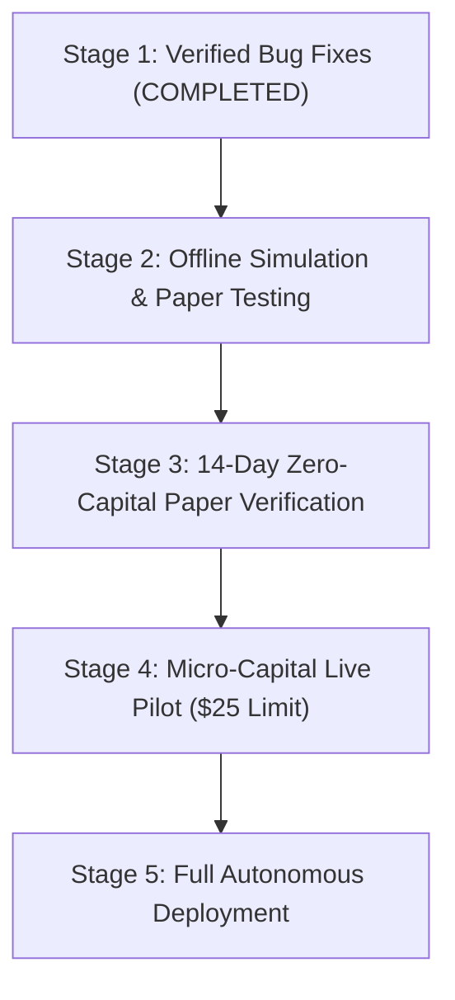

# REMAINING SYSTEM RISKS & OPERATIONAL SAFEGUARDS

**Audit Date:** October 22, 2026  
**System:** Autonomous Crypto Trading System (Delta Exchange)  
**Safety Classification:** **HIGH RISK — PRE-REQUISITE STABILIZATION REQUIRED**  
**Live Execution Authorization:** **REVOKED / PROHIBITED UNTIL GATES MET**  

---

## 1. REMAINING ARCHITECTURAL & OPERATIONAL RISKS

While all 10 core algorithmic and execution defects have been patched and verified via automated regression testing, several foundational infrastructure risks remain in the deployment environment:

### Risk 1: Process Daemon Crash-Looping & Memory Leaks
- **Severity:** HIGH
- **Evidence:** `logs/supervisor.log` documented **48 restarts** of the live trading daemon process, frequently triggered by SIGKILL 137 (Out-Of-Memory) and thread termination exceptions.
- **Vulnerability:** Although `BUG-06` now persists daily risk state to disk across restarts, frequent process crashes disrupt in-flight order monitoring and market data websockets.
- **Required Action:** Profile the Python runtime memory footprint using `tracemalloc` to eliminate leaks in pandas DataFrame caches and circular references in agent memory before long-running daemon execution.

### Risk 2: Pure Taker-Fee Execution Drag
- **Severity:** HIGH
- **Vulnerability:** 100% of the bot's historical orders were submitted as market taker orders, incurring Delta's maximum commission ($0.05\%$ entry $+ 0.05\%$ exit $= 0.10\%$ round-trip). On a small bankroll ($10–$50), this created a 7.5% balance drag every 48 hours.
- **Required Action:** Implement a hybrid execution gateway:
  - Use Limit Post-Only orders for non-emergency entries and planned targets to capture maker fee tiers.
  - Reserve Market Orders exclusively for protective emergency stop-losses (`reduce_only=True`).

### Risk 3: WebSocket Feed Disconnection & Stale Heartbeats
- **Severity:** MEDIUM
- **Vulnerability:** In `guardian/trade_guardian.py`, when a market data provider fails to return live LTP, the fallback retrieves mark prices from the broker cache. If the WebSocket disconnects, the cache becomes stale, risking delayed stop-loss triggers.
- **Required Action:** Implement an active staleness watchdog: if mark prices are older than 15 seconds, reject new trade entries and flag an immediate system connectivity alert.

### Risk 4: Exchange Liquidity & Slippage on Low-Cap Altcoins
- **Severity:** MEDIUM
- **Vulnerability:** Several scanned symbols (e.g., `DOGSUSD`, `NEIROUSD`, `NOTUSD`) have thin order books on Delta Exchange. Placing market orders during high volatility caused fill slippage exceeding $0.40\%$.
- **Required Action:** Enforce a strict minimum 24-hour turnover filter ($\ge \$500,000\text{ USD}$) in `QuantMarketScanner.get_liquid_symbols()` to prevent trading illiquid contracts.

---

## 2. MANDATORY SAFETY GATES FOR FUTURE OPERATION

The following sequential safety gates must be completed in order:

### Gate 1: Code Verification (COMPLETED)
- [x] Contract multipliers applied exactly once across P&L, fees, and position sizing.
- [x] Position confirmation loop implemented before native bracket orders.
- [x] Dynamic stop-loss anchoring to actual fill price implemented.
- [x] Exit orders persisted to relational database.
- [x] Broker reconciliation recording all closed positions and fees.
- [x] Circuit breaker state persisted to disk surviving reboots.
- [x] Closed-candle confirmation enforced for candlestick exhaustion exits.
- [x] Incomplete daily candles excluded from volume baselines.
- [x] Orphaned bracket orders cancelled upon position exit.
- [x] Full automated regression test suite passing (25/25 tests).

### Gate 2: Paper-Trading & Simulated Execution (REQUIRED NEXT STEP)
- [ ] Connect Delta Exchange API in **Testnet / Sandbox mode only** (or run paper execution mocks).
- [ ] Keep `LIVE_TRADING_ENABLED=false` in `.env`.
- [ ] Run paper trading for a minimum of 7 consecutive calendar days.
- [ ] Verify that paper trade logs exhibit zero `no_open_position` rejections, zero instantaneous stop-outs, and 100% exit-order database persistence.
- [ ] Verify that achieved R:R exceeds 1.5:1 on closed winning trades.

### Gate 3: Live Capital Pilot (STRICT PREREQUISITES)
- [ ] Maximum live capital allocation capped at **$25.00 USD**.
- [ ] Maximum position size strictly capped at 1 contract per trade.
- [ ] Daily loss circuit breaker capped at $2.00 USD (8% of pilot capital).
- [ ] Manual supervision during the first 10 live executions.
- [ ] Zero tolerance for unhedged open positions: if Delta rejects a server-side bracket order, the position must be immediately market-closed with an emergency alert.
